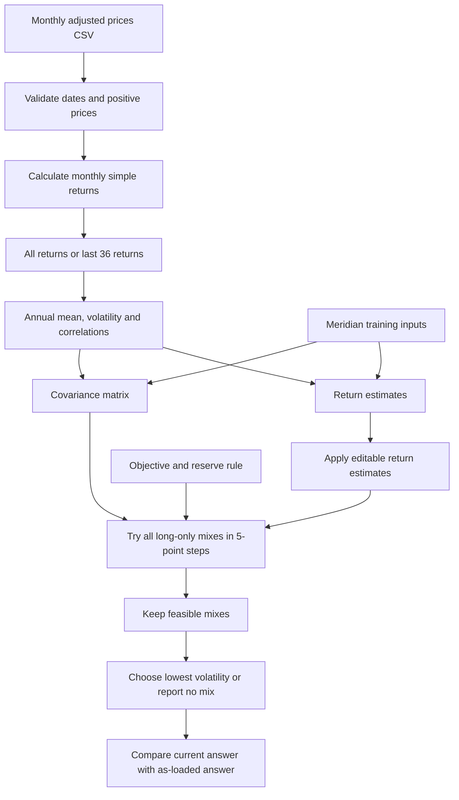

# Lab 15 - Portfolio Stability Decision

A learning demonstration, not investment advice.

## Preparation

Selected universe: SGOV (cash/reserves), SCHR (government bonds), VTC (corporate bonds), ACWI (global stocks).
Proposed client: university scholarship fund. Objective: CPI + 3%; using an explicit 2.5% inflation assumption gives 5.5%.
Proposed modeled hard constraint: at least 3% SGOV. The wider mandate has other rules not tested by this search.

## Run

```powershell
python portfolio.py
python -m streamlit run app.py
```

## Engine flowchart



## Validation

Checks passed October 22, 2026. Reported the initial app walkthrough looked correct, then explicitly confirmed that the 0.50 correlation test matched the expected values and that both entries were restored to 0.25.

| Meridian run | Bills / 10-year / IG / equity (%) | Return | Volatility |
|---|---|---|---|
| As loaded | 0 / 20 / 25 / 55 | 6.51% | 9.44% |
| Equity expected return 8% to 7% | 0 / 10 / 10 / 80 | 6.53% | 12.94% |
| IG-equity correlation 0.50 with equity return at 8% | 0 / 40 / 0 / 60 | 6.52% | 9.73% |

The equity-return stress moves the largest weight by 25 percentage points.
App tests confirmed the baseline, equity stress, infeasible message, and engine correlation change.
Both correlation cells were restored to 0.25 and the restored app result verified.
Lab 14 printed output is unchanged.
CSV estimation matched independent pandas calculations using synthetic test data,
for all months and the last 36 returns. These are test fixtures, not actual fund data.
The real CSV was tested through the app upload path using a simulated uploader. Both the all-month and last-36-month controls produced the engine results below without app errors. A user browser upload is the next walkthrough step.
Sample standard deviations are annualized by square root of 12; arithmetic monthly means by 12.
Last 36 means 36 monthly returns from 37 prices. Dates must be consecutive monthly observations.
The grid search uses 5-point weights, so a 3% reserve minimum requires at least 5% on this grid.

## Fund prices and sources

[prices.csv](prices.csv) contains 61 month-end adjusted-close observations per fund, September 30, 2021 through September 30, 2026. This produces 60 monthly returns: October 2021 through September 2026. The additional opening price is needed to calculate the first return. October 2026 is excluded because it was incomplete on the download date.

| Ticker | Fund and role | Price source | Download date |
|---|---|---|---|
| SGOV | [iShares 0-3 Month Treasury Bond ETF](https://www.ishares.com/us/products/314116/ishares-0-3-month-treasury-bond-etf); Cash and payout reserves | [Yahoo Finance adjusted close](https://finance.yahoo.com/quote/SGOV/history/) | 2026-10-22 |
| SCHR | [Schwab Intermediate-Term U.S. Treasury ETF](https://www.schwabassetmanagement.com/products/schr); Government bonds | [Yahoo Finance adjusted close](https://finance.yahoo.com/quote/SCHR/history/) | 2026-10-22 |
| VTC | [Vanguard Total Corporate Bond ETF](https://workplace.vanguard.com/assets/corp/fund_communications/pdf_publish/us-products/fact-sheet/F0985.pdf); Investment-grade corporate bonds | [Yahoo Finance adjusted close](https://finance.yahoo.com/quote/VTC/history/) | 2026-10-22 |
| ACWI | [iShares MSCI ACWI ETF](https://www.ishares.com/us/products/239600/ishares-msci-acwi-etf); Global equities | [Yahoo Finance adjusted close](https://finance.yahoo.com/quote/ACWI/history/) | 2026-10-22 |

Method: downloaded Yahoo Finance daily chart data with adjusted closes, then selected the final trading-day adjusted close in each calendar month. These are monthly observations derived from daily adjusted closes, not unadjusted closing prices or monthly averages. Prices are USD per share as adjusted by the provider for distributions and splits. All four funds share the same 61 dates, oldest first, with no missing, duplicate, zero, or negative values. Original numeric precision is retained.

Raw downloads, exact request URLs, UTC retrieval timestamps, and SHA-256 hashes are retained in `lab15_data/`. Sources and values were checked before CSV creation. Adjusted history is the provider version retrieved on October 22, 2026; it is not a point-in-time historical snapshot.

These historical return averages are labeled estimates and are not forecasts.

## Own-universe results

Mandate used: 5.5% annual expected-return objective (CPI + 3% with a stated 2.5% inflation assumption); at least 3% SGOV reserves; long-only. The objective is held fixed across both windows. Only SGOV is marked reserve-eligible for this proposed scholarship mandate.

| Window | SGOV | SCHR | VTC | ACWI | Expected return estimate | Volatility estimate | Reserve share |
|---|---:|---:|---:|---:|---:|---:|---:|
| All 60 monthly returns | 75.00% | 0.00% | 0.00% | 25.00% | 5.82% | 3.81% | 75.00% |
| Last 36 monthly returns | 90.00% | 0.00% | 0.00% | 10.00% | 6.05% | 1.19% | 90.00% |

Largest absolute weight change: **15.00 percentage points**. SGOV rises from 75% to 90%; ACWI falls from 25% to 10%. SCHR and VTC remain at zero.

The last-36-month window uses September 29, 2023 through September 30, 2026 prices to calculate October 2023 through September 2026 returns.

| Fund | All-month annual return estimate | Last-36-month annual return estimate |
|---|---:|---:|
| SGOV | 3.72% | 4.44% |
| SCHR | -0.30% | 3.53% |
| VTC | -0.15% | 5.02% |
| ACWI | 12.14% | 20.50% |

Interpretation: the more recent sample estimates higher returns for SGOV and ACWI, allowing the return objective to be met with less equity. The allocation depends on the estimation window. These results are the lowest-volatility feasible allocations on the 5-percentage-point grid, not a guarantee of future performance or full compliance with every rule in the wider mandate.

Verification: CSV values match the downloaded observations; annual means and covariance estimates match an independent pandas calculation; the Streamlit upload path and window switch match these engine results. The student decision is recorded below.

## Partner code question

**Partner question:** Why doesn't the search select the portfolio with the highest return?

**My answer:** The goal is to minimize volatility while meeting the return and reserve requirements. Once a portfolio meets those requirements, the search compares its risk.

## Partner estimate test

**Challenge:** The five-year ACWI return estimate may be optimistic. What happens if its annual expected return is one percentage point lower?

Test: all 60 monthly returns; reduce ACWI from 12.141314% to 11.141314%, using the unrounded estimate in the calculation. Keep the 5.5% objective, 3% SGOV reserve minimum, other return estimates, and covariance matrix unchanged.

| Result | As loaded | Simulated stress |
|---|---:|---:|
| SGOV weight | 75% | 75% |
| SCHR weight | 0% | 0% |
| VTC weight | 0% | 0% |
| ACWI weight | 25% | 25% |
| Expected return estimate | 5.82% | 5.57% |
| Volatility estimate | 3.81% | 3.81% |
| Reserve share | 75% | 75% |

Largest absolute weight change: **0.00 percentage points**. Results were computed with portfolio.py.

**Response:** Reducing ACWI's expected return by one percentage point leaves the allocation at 75% SGOV and 25% ACWI, while estimated portfolio return falls from 5.82% to 5.57% and still meets the 5.5% objective. The allocation survives this particular stress on the 5-point grid, but the 15-point shift under the last-36-month window shows sensitivity to the estimation period.

## My decision: pilot

I would pilot the 75% SGOV / 25% ACWI allocation. Lowering ACWI's expected return by one percentage point left the allocation unchanged and its expected return above the 5.5% objective. However, switching estimation windows shifted the weights by 15 percentage points, showing that the result depends on the historical period used. I would consider adopting it after testing additional estimation windows and return assumptions and confirming that it meets the scholarship fund's full mandate.

## Estimation-risk reflection

A small change in expected returns can cause a big allocation change because the search must still meet the return target while choosing the lowest-risk mix. If an estimate falls, the previous mix may no longer qualify, forcing the search to choose a different combination. In the Meridian test, lowering equity's expected return from 8% to 7% increased its weight from 55% to 80%. The search needed more stocks to meet the same target, even though that increased risk. This shows why the selected portfolio depends heavily on estimates that may be wrong.

### Search function, in code order

| Code | Explanation |
|---|---|
| `def search_portfolio(returns, covariance, objective, reserve_minimum, reserve_indices)` | Accept annual return estimates, the covariance matrix, the required return, the reserve minimum, and the positions of assets that count as reserves. |
| `size = len(returns)` | Count how many assets the search must allocate money across. |
| `if not 1 <= size <= 6` | Stop if the engine receives an unsupported number of assets. The CSV interface specifically expects three to six. |
| `all(math.isfinite(x) ...)` | Reject missing or infinite numeric assumptions instead of calculating a misleading result. |
| `if not 0 <= reserve_minimum <= 1` | Check that the reserve minimum lies between 0% and 100%; the engine uses decimal weights. |
| `if any(i < 0 or i >= size ...)` | Check that each reserve index refers to an existing asset. |
| Covariance dimension check | Require one covariance row and column per asset. |
| `def allocations(slots, remaining)` | Define a helper that distributes the remaining 5% units across the remaining asset slots. |
| `if slots == 1` | When only one asset remains, it must receive all the units left. |
| `yield [remaining / 20]` | Produce the final asset's weight as a decimal. Twenty units equal the whole portfolio. |
| `for units in range(remaining + 1)` | Try every possible number of units for the current asset, from zero through everything remaining. |
| `allocations(slots - 1, remaining - units)` | Recursively distribute the leftover units among the other assets. Each call has fewer slots, so the process reaches the final asset. |
| `yield [units / 20] + rest` | Combine the current asset's weight with the other weights and produce one complete allocation. `yield` supplies allocations one at a time. |
| `best = None` | Start without a qualifying portfolio. |
| `for weights in allocations(size, 20)` | Examine every long-only mix on the 5-point grid. Allocating all 20 units ensures weights sum to 100%. |
| `result = expected_return(weights, returns)` | Calculate the mix's weighted-average return estimate using the existing engine function. |
| `reserve = reserve_weight(weights, reserve_indices)` | Add the weights of the reserve-eligible assets. |
| `if result < objective - 1e-12 or reserve < reserve_minimum - 1e-12` | Check whether either requirement fails. The tiny tolerance prevents floating-point rounding from rejecting a mix exactly on the boundary. |
| `continue` | Skip a failing mix and examine the next allocation. |
| `risk = portfolio_volatility(weights, covariance)` | Calculate volatility for a mix that meets both requirements. This includes how the assets move together. |
| `if best is None or risk < best["volatility"]` | Keep the first qualifying mix, then replace it only when a lower-volatility qualifying mix is found. An exact risk tie keeps the first encountered mix. |
| `best = {...}` | Store the chosen weights, return, volatility, and reserve share together. |
| `return best` | Return the lowest-risk qualifying grid allocation, or `None` if no mix qualifies. The app displays "no mix meets the objective" for `None`. |

The search minimizes volatility subject to the objective and reserve rule. It does not maximize return. With four assets, it considers 1,771 allocations; it does not try every possible fractional allocation between grid points. A 3% reserve floor requires at least 5% in eligible assets on this grid.

### Written explanation of the engine and results

The app starts with monthly adjusted prices and converts them into monthly returns. It uses either all 60 returns or the last 36 to estimate annual returns, annual volatility, and correlations, then builds a covariance matrix. The search divides the portfolio into twenty 5% pieces and tries every way to distribute them across the funds. It skips allocations that miss the return target or reserve minimum. Among the remaining allocations, it keeps the one with the lowest volatility. If no allocation qualifies, it reports that honestly rather than lowering the objective.

Our all-month result is 75% SGOV and 25% ACWI, with a 5.82% return estimate and 3.81% volatility. Using the last 36 months changes it to 90% SGOV and 10% ACWI, a 15-percentage-point shift, even though our objective and reserve rule stay the same. That shows estimation risk: different samples produce different inputs and allocations. I would pilot the allocation and test additional windows and return assumptions, then check the full scholarship mandate before considering adoption.

### Completed flowchart-to-code comparison

The Mermaid flowchart was compared with the implemented functions in `portfolio.py` and the controls and result display in `app.py`. The main calculation sequence matches the implementation.

| Flowchart step | Corresponding implementation | Comparison |
|---|---|---|
| Read and validate adjusted prices | `estimate_from_csv()` checks dates, consecutive months, and positive finite prices. | Matches. |
| Calculate monthly returns | `current[i] / previous[i] - 1` | Matches. Returns are calculated before the window is selected. |
| Choose the estimation window | `monthly = monthly[-36:]` when the switch is enabled. | Matches. The recent window contains 36 returns, requiring 37 prices. |
| Annual estimates and covariance | Monthly mean times 12; sample standard deviation times square root of 12; correlations passed to `build_covariance()`. | Matches. Covariance accounts for how assets move together. |
| Editable estimates and mandate | `app.py` passes return-box values, the covariance matrix, objective, reserve minimum, and eligible-asset indices to the search. | Matches. Editing a return does not change covariance. |
| Generate candidate allocations | `allocations(size, 20)` distributes twenty 5% units. | Matches. All candidates are long-only and total 100%. |
| Filter and select | `continue` skips failing mixes; the `best` comparison retains the lowest volatility. | Matches. If no mix qualifies, the function returns `None`. |
| Display the original/current comparison | `app.py` calls the search for the original inputs and current inputs, then computes the largest absolute weight difference times 100. | Matches. Both runs use the selected mandate; the original CSV baseline uses all months. |

The chart also correctly includes a separate Meridian branch, which supplies training estimates directly instead of reading prices. The drawing is a high-level representation: recursive allocation generation and individual error checks are details inside its boxes. The comparison display belongs to `app.py`, while the financial calculations belong to `portfolio.py`.
